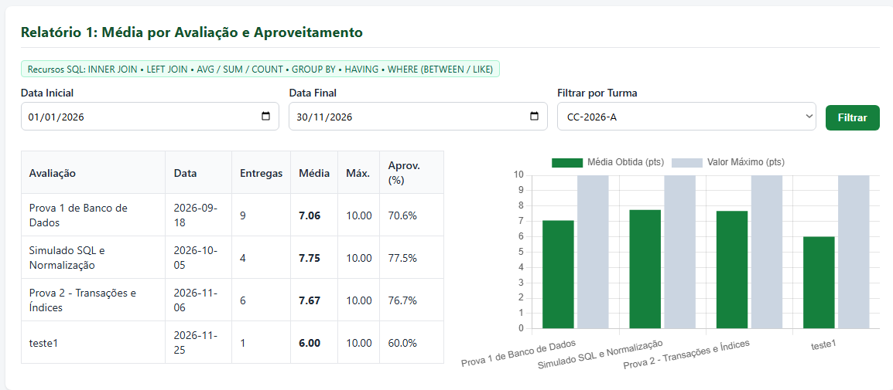
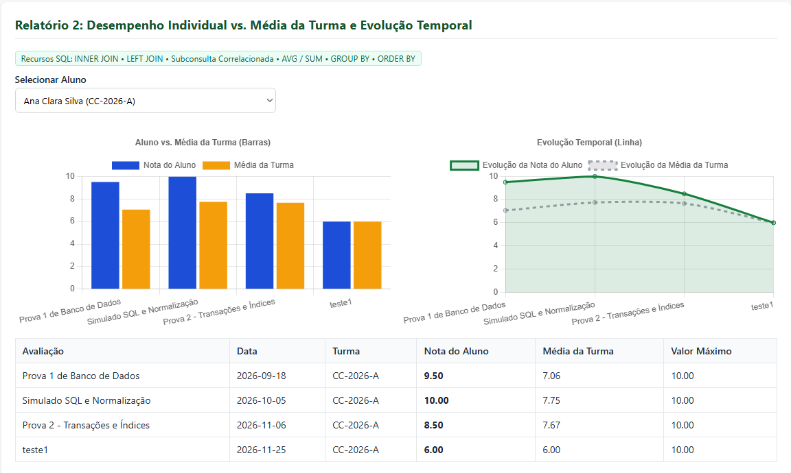
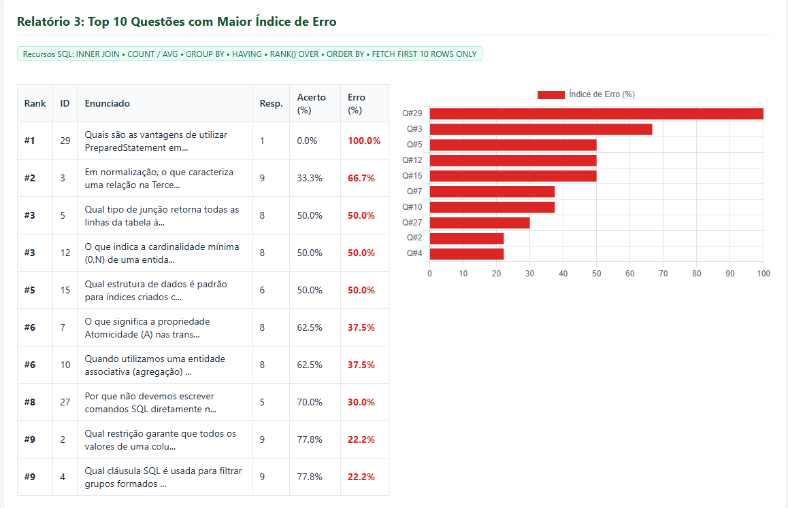
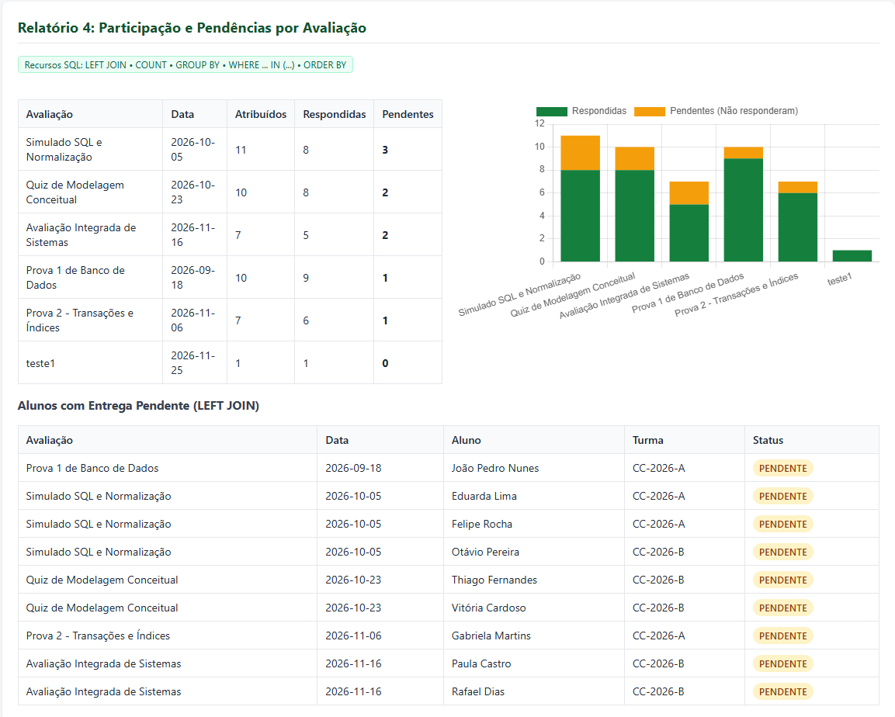

# Sistema Web de Avaliações

Projeto final da disciplina **Banco de Dados I (UEL)** — Prof. Dr. Anderson Paulo Avila Santos.

## Integrantes

- Daniel Trevisan Tirado Santos

## Natureza do Sistema e Particularidade

- **Natureza escolhida:** Avaliação de aprendizagem (provas, simulados e quizzes).
- **Particularidade implementada:** Cada questão tem um valor na avaliação. O sistema registra a nota obtida em cada questão (automática nas objetivas, dada pelo professor nas de texto livre) e calcula a nota total de cada aluno.


## Como Rodar o Sistema (Passo a Passo)

### 1. Pré-requisitos
- **Java 17** ou superior instalado.
- **PostgreSQL** em execução (porta padrão `5432`).

### 2. Criar e carregar o banco de dados (`schema.sql` e `carga.sql`)
Criar um banco de dados vazio no PostgreSQL e nomear `avaliacoes_db`, abrir a Query Tool e executar os codigos `.sql` nesta ordem:
- Primeiro rode `database/schema.sql` para criar as tabelas
- Após isso rode `database/carga.sql` para iniciar o banco com registros
### 3. Configurar credenciais de acesso
As configurações padrão estão em `src/main/resources/application.properties`:

- `DB_URL` (padrão: `jdbc:postgresql://localhost:5432/avaliacoes_db`)
- `DB_USER` (padrão: `postgres`)
- `DB_PASSWORD` (padrão: `sql0812`)
- `SERVER_PORT` (padrão: `8080`)

Ajuste o arquivo `application.properties` conforme a sua instalação do PostgreSQL (usuário, senha, etc).

### 4. Iniciar a aplicação
No diretório `sistema-web-avaliacoes`:

- **Windows (PowerShell/CMD):**
  ```cmd
  .\mvnw.cmd spring-boot:run
  ```
- **Linux / macOS:**
  ```bash
  ./mvnw spring-boot:run
  ```

### 5. Acessar no navegador
Abra `http://localhost:8080`. Na tela de login há dois botões para preencher credenciais de teste:
- **Professor:** `carlos.mendes@uel.br` / `123456`
- **Aluna:** `ana.silva@uel.br` / `123456`

Ao efetuar o login, poderá testar todas as funções da aplicação, tanto para alunos, quanto para professores. O `carga.sql` já traz algumas questões (multipla escolha e discursivas) e avaliações, permitindo testar a realização de provas por alunos, correção de questões discursivas por professores, e visualizar relatórios por ambos (já haverão relatórios, devido aos alunos e às avaliações já cadastrados).

---

## Relatórios (RF7)

Todas as consultas também estão documentadas em [`database/relatorios.sql`](database/relatorios.sql).

### Relatório 1: Média por Avaliação e Aproveitamento

- **Objetivo:** Apresentar a média aritmética das notas, a quantidade de entregas, o valor máximo e o percentual de aproveitamento por avaliação, com filtros opcionais por período e turma (exibindo tabela e gráfico de barras).
- **Recursos SQL utilizados:** Junção interna (`INNER JOIN`), Junção externa (`LEFT JOIN`), Agregação e agrupamento (`COUNT`, `AVG`, `SUM`, `GROUP BY`, `HAVING`), Subconsulta escalar, Ordenação (`ORDER BY`) e Filtros diversos (`WHERE` com `BETWEEN` e `LIKE`).
- **SQL utilizado:**
```sql
WITH notas_avaliacao AS (
    SELECT
        a.id_avaliacao,
        a.titulo,
        a.data_aplicacao,
        au.id_aluno,
        u.turma,
        COALESCE(SUM(r.nota_obtida), 0) AS nota_aluno
    FROM avaliacao a
    INNER JOIN avaliacao_usuario au ON au.id_avaliacao = a.id_avaliacao
    INNER JOIN usuario u ON u.id_usuario = au.id_aluno
    LEFT JOIN resposta r ON r.id_avaliacao = a.id_avaliacao AND r.id_aluno = au.id_aluno
    WHERE au.status <> 'PENDENTE'
      AND a.data_aplicacao BETWEEN ? AND ?
      AND COALESCE(u.turma, '') LIKE ?
    GROUP BY a.id_avaliacao, a.titulo, a.data_aplicacao, au.id_aluno, u.turma
)
SELECT
    na.id_avaliacao,
    na.titulo,
    na.data_aplicacao,
    COUNT(na.id_aluno) AS qtd_entregas,
    ROUND(AVG(na.nota_aluno), 2) AS media_notas,
    (SELECT COALESCE(SUM(aq.valor), 0) FROM avaliacao_questao aq WHERE aq.id_avaliacao = na.id_avaliacao) AS valor_maximo,
    ROUND(
        (AVG(na.nota_aluno) / NULLIF((SELECT SUM(aq.valor) FROM avaliacao_questao aq WHERE aq.id_avaliacao = na.id_avaliacao), 0)) * 100,
        2
    ) AS percentual_aproveitamento
FROM notas_avaliacao na
GROUP BY na.id_avaliacao, na.titulo, na.data_aplicacao
HAVING COUNT(na.id_aluno) >= 1
ORDER BY na.data_aplicacao ASC, na.id_avaliacao ASC;
```

### Relatório 2: Desempenho Individual vs. Média da Turma e Evolução Temporal

- **Objetivo:** Comparar a nota obtida por um aluno em cada avaliação com a média da sua turma (gráfico de barras lado a lado) e acompanhar sua evolução ao longo das datas de aplicação (gráfico de linha e tabela).
- **Recursos SQL utilizados:** Junção interna (`INNER JOIN`), Junção externa (`LEFT JOIN`), Agregação e agrupamento (`AVG`, `SUM`, `GROUP BY`), Subconsulta correlacionada e Ordenação (`ORDER BY`).
- **SQL utilizado:**
```sql
WITH notas_alunos AS (
    SELECT
        au.id_avaliacao,
        a.titulo,
        a.data_aplicacao,
        au.id_aluno,
        u.nome AS nome_aluno,
        u.turma,
        COALESCE(SUM(r.nota_obtida), 0) AS nota_obtida
    FROM avaliacao_usuario au
    INNER JOIN avaliacao a ON a.id_avaliacao = au.id_avaliacao
    INNER JOIN usuario u ON u.id_usuario = au.id_aluno
    LEFT JOIN resposta r ON r.id_avaliacao = au.id_avaliacao AND r.id_aluno = au.id_aluno
    WHERE au.status <> 'PENDENTE'
    GROUP BY au.id_avaliacao, a.titulo, a.data_aplicacao, au.id_aluno, u.nome, u.turma
)
SELECT
    na.id_avaliacao,
    na.titulo,
    na.data_aplicacao,
    na.nome_aluno,
    na.turma,
    ROUND(na.nota_obtida, 2) AS nota_aluno,
    (
        SELECT ROUND(AVG(na2.nota_obtida), 2)
        FROM notas_alunos na2
        WHERE na2.id_avaliacao = na.id_avaliacao
          AND na2.turma IS NOT DISTINCT FROM na.turma
    ) AS media_turma,
    (SELECT COALESCE(SUM(aq.valor), 0) FROM avaliacao_questao aq WHERE aq.id_avaliacao = na.id_avaliacao) AS valor_maximo
FROM notas_alunos na
WHERE na.id_aluno = ?
ORDER BY na.data_aplicacao ASC, na.id_avaliacao ASC;
```

### Relatório 3: Top 10 Questões com Maior Índice de Erro

- **Objetivo:** Ranquear as 10 questões com maior percentual médio de erro considerando as respostas já corrigidas, exibindo tabela e gráfico de barras horizontais para identificar conteúdos com maior dificuldade.
- **Recursos SQL utilizados:** Junção interna (`INNER JOIN`), Agregação e agrupamento (`COUNT`, `AVG`, `GROUP BY`, `HAVING`), Ordenação e ranking (`RANK() OVER`, `ORDER BY`, `FETCH FIRST 10 ROWS ONLY`) e Filtro (`WHERE ... IN (...)`).
- **SQL utilizado:**
```sql
WITH metricas_questao AS (
    SELECT
        q.id_questao,
        q.disciplina,
        q.tipo,
        q.enunciado,
        COUNT(r.id_resposta) AS total_respostas,
        ROUND(AVG((r.nota_obtida / NULLIF(aq.valor, 0)) * 100), 2) AS percentual_acerto,
        ROUND(100 - AVG((r.nota_obtida / NULLIF(aq.valor, 0)) * 100), 2) AS percentual_erro
    FROM resposta r
    INNER JOIN questao q ON q.id_questao = r.id_questao
    INNER JOIN avaliacao_questao aq ON aq.id_avaliacao = r.id_avaliacao AND aq.id_questao = r.id_questao
    WHERE r.corrigida = TRUE
      AND q.tipo IN ('MULTIPLA_ESCOLHA', 'TEXTO_LIVRE')
    GROUP BY q.id_questao, q.disciplina, q.tipo, q.enunciado
    HAVING COUNT(r.id_resposta) >= 1
)
SELECT
    RANK() OVER (ORDER BY percentual_erro DESC, total_respostas DESC) AS posicao,
    id_questao,
    disciplina,
    tipo,
    enunciado,
    total_respostas,
    percentual_acerto,
    percentual_erro
FROM metricas_questao
ORDER BY percentual_erro DESC, total_respostas DESC
FETCH FIRST 10 ROWS ONLY;
```

### Relatório 4: Participação e Pendências por Avaliação

- **Objetivo:** Exibir o resumo de alunos atribuídos, respondidos e pendentes por avaliação (gráfico empilhado e tabela resumo) e listar os alunos que ainda não responderam cada avaliação.
- **Recursos SQL utilizados:** Junção externa (`LEFT JOIN`), Junção interna (`INNER JOIN`), Agregação e agrupamento (`COUNT`, `GROUP BY`), Filtro (`WHERE ... IN (...)`) e Ordenação (`ORDER BY`).
- **SQL utilizado:**
```sql
SELECT
    a.id_avaliacao,
    a.titulo,
    a.data_aplicacao,
    COUNT(au.id_aluno) AS total_atribuidos,
    COUNT(CASE WHEN au.status = 'PENDENTE' THEN 1 END) AS total_pendentes,
    COUNT(CASE WHEN au.status <> 'PENDENTE' THEN 1 END) AS total_respondidas
FROM avaliacao a
LEFT JOIN avaliacao_usuario au ON au.id_avaliacao = a.id_avaliacao
GROUP BY a.id_avaliacao, a.titulo, a.data_aplicacao
ORDER BY total_pendentes DESC, a.data_aplicacao ASC;

-- Alunos pendentes por avaliação
SELECT
    a.titulo AS avaliacao,
    a.data_aplicacao,
    u.nome AS aluno_pendente,
    u.turma,
    au.status
FROM avaliacao a
INNER JOIN avaliacao_usuario au ON au.id_avaliacao = a.id_avaliacao
INNER JOIN usuario u ON u.id_usuario = au.id_aluno
WHERE au.status IN ('PENDENTE')
ORDER BY a.data_aplicacao ASC, u.turma, u.nome;
```
